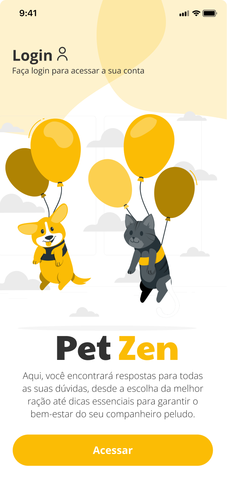

Адаптивный лендинг для приложения о питомцах, свёрстанный по макету из Figma.

## 🚀 Демо

## 🛠️ Технологии
- HTML5 (семантическая вёрстка)
- CSS3 (Flexbox, Grid, CSS-переменные, медиа-запросы)
- Vanilla JavaScript (бургер-меню, анимации, валидация форм)

## ✨ Что реализовано
- Адаптивная вёрстка под мобильные, планшеты и десктоп.
- Интерактивное мобильное меню.
- Анимация появления элементов при скролле (IntersectionObserver).
- Валидация форм подписки и логина с показом уведомлений (тостов).
- Страница входа (Login) с формой и кнопками соцсетей.

## 🎨 Дизайн
Макет взят из открытого сообщества Figma (автор: danycodes).
[Ссылка на оригинальный макет в Figma](https://www.figma.com/files/team/961321473631029762/resources/community/file/1333739760381547963?q_id=9d12d6c1-1a98-4758-9ce4-53cf891e613d)

## 📸 Скриншоты

